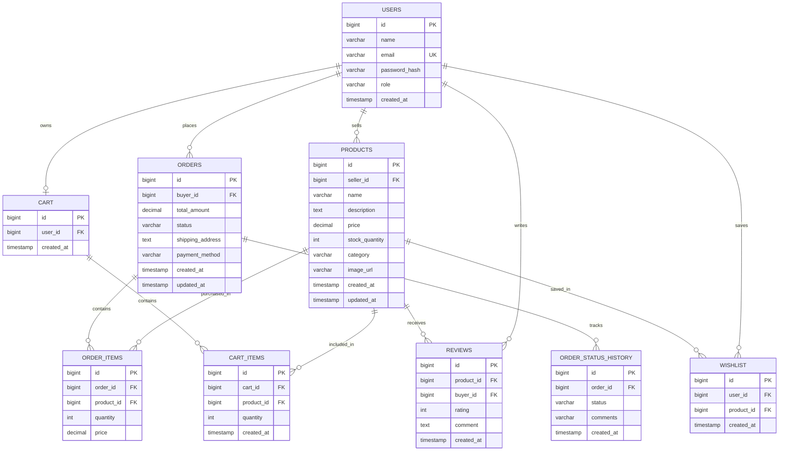
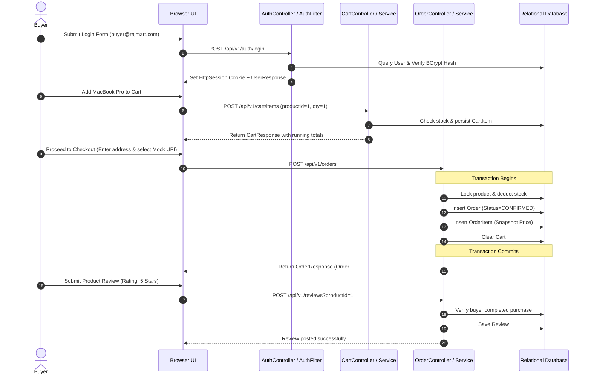
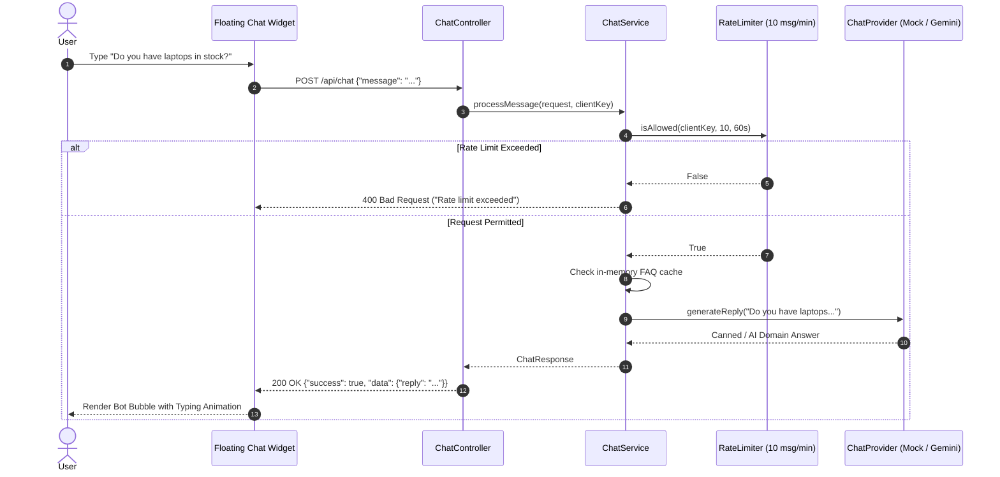

# 🛍️ RAJ MART — Full-Stack E-Commerce Web Application with AI Chatbot

[](https://www.oracle.com/java/)
[](https://spring.io/projects/spring-boot)
[]()
[-blue.svg)]()
[]()

> **RAJ MART** is a brand-new, production-style, multi-role e-commerce web application engineered from the ground up with strict layered architecture (Controller → Service → DAO → Database), pure PreparedStatement JDBC data access, HikariCP connection pooling, BCrypt authentication, role-based authorization, mock checkout with transactional stock deduction, verified customer reviews, and an integrated **AI Product/FAQ Chatbot** (offline-first Mock provider + Google Gemini fallback).

---

## 📑 Table of Contents
1. [Key Features (F1–F8 + O1–O4)](#-key-features)
2. [Architecture & Layering](#-architecture--layering)
3. [Technology Stack](#-technology-stack)
4. [Architecture Diagrams](#-architecture-diagrams)
   - [D1 — Entity-Relationship (ER) Diagram](#d1--entity-relationship-er-diagram)
   - [D2 — Use Case Diagram](#d2--use-case-diagram)
   - [D3 — Sequence Diagrams](#d3--sequence-diagrams)
5. [Database Schema](#-database-schema)
6. [REST API Documentation](#-rest-api-documentation)
7. [AI Chatbot Architecture](#-ai-chatbot-architecture)
8. [Security Checklist](#-security-checklist)
9. [Getting Started & Local Setup](#-getting-started--local-setup)
10. [Default Demo Credentials](#-default-demo-credentials)
11. [Running Tests](#-running-tests)
12. [Docker & Cloud Deployment](#-docker--cloud-deployment)
13. [Known Limitations](#-known-limitations)

---

## 🌟 Key Features

### Core Features (F1 – F8)
- **F1 — Registration & Authentication**:
  - Secure Buyer & Seller self-registration with duplicate-email protection, email format validation, and password strength requirements.
  - Seeded Administrator account (no public admin registration).
  - Session-based authentication with `HttpSession`, session fixation protection on login, and explicit 30-minute inactivity timeout.
  - Passwords hashed with **BCrypt (strength 12)**; never stored in plaintext or logged.
- **F2 — Seller Product Management**:
  - Seller dashboard for listing products, editing details, updating stock levels, adjusting prices, and deleting listings.
  - Strict server-side ownership enforcement: sellers can only edit/delete their own products.
- **F3 — Buyer Product Browsing & Search**:
  - Filter by category (`Electronics`, `Fashion`, `Home & Kitchen`, `Books`, `Sports`), keyword search across titles and descriptions, in-stock filters, sorting (`Price: Low to High`, `Price: High to Low`, `Newest Arrivals`, `Alphabetical`), and server-side pagination.
- **F4 — Shopping Cart**:
  - Add to cart, adjust quantities (+ / -), remove items, save for later.
  - Real-time stock validation preventing purchases exceeding inventory.
  - Server-side calculation of running subtotals, 5% estimated tax, shipping fees (free over $50), and total price.
- **F5 — Mock Payment & Checkout**:
  - Multi-step checkout with delivery address collection and mock payment methods (**Mock UPI**, **Mock Credit/Debit Card**, **Cash on Delivery**).
  - Atomic transactional stock deduction: verifies stock under lock, deducts inventory, records purchase price snapshots in `order_items`, and clears cart.
- **F6 — Order Management & Status Workflow**:
  - Buyer order history with snapshot pricing and cancellation support.
  - Seller order feed showing purchases containing their products.
  - State machine order workflow: `PENDING` → `CONFIRMED` → `PACKED` → `SHIPPED` → `DELIVERED` (or `CANCELLED`).
  - Automatic inventory replenishment when an order is cancelled.
- **F7 — Admin Panel**:
  - Real-time platform KPI metrics (Total Users, Buyers, Sellers, Total Products, Orders, Gross Merchandise Revenue).
  - User Directory with role filtering (`BUYER`, `SELLER`, `ADMIN`).
  - Product Catalog moderation and removal.
  - Platform-wide order oversight and administrative status override.
- **F8 — Customer Reviews & Star Ratings**:
  - **Verified Buyer Rule**: Only users who completed a purchase of a product can review it.
  - 1 to 5 star ratings with detailed comments.
  - One review per product per buyer to prevent spam.

### Optional Enhancements (O1 – O4)
- **O1 — Wishlist / Save for Later**: Save items to wishlist and transfer directly back to cart in one click.
- **O2 — Order Status Lifecycle Workflow**: Validated transitions ensuring orders cannot transition illegally (e.g. delivered orders cannot be cancelled).
- **O3 — Seller Sales Dashboard**: Real-time seller metrics for products listed, units sold, total revenue, and incoming orders.
- **O4 — AI Shopping Chatbot**: Floating interactive widget embedded across all pages. Default offline `MockChatProvider` with comprehensive domain FAQ responses + `GeminiChatProvider` fallback.

---

## 🏗️ Architecture & Layering

RajMart strictly adheres to an enterprise **Layered MVC / REST Architecture**:

```
Client Browser (Vanilla HTML5 / CSS3 / JavaScript)
    │
    │  REST JSON Requests & Session Cookies
    ▼
AuthFilter / EncodingFilter / CORSFilter (Security Boundary)
    │
    ▼
Controller Layer (Spring Web @RestController)
    │  (Validates HTTP inputs, accepts/returns DTO envelopes)
    ▼
Service Layer (Business Logic & Transactions)
    │  (Validates business invariants before database calls)
    ▼
DAO Layer (Data Access Object Pattern)
    │  (Pure PreparedStatement JDBC with try-with-resources)
    ▼
HikariCP Connection Pool
    │
    ▼
Relational Database (H2 In-Memory for Dev/Test | MySQL 8.x for Production)
```

### Architectural Principles Enforced:
1. **Zero SQL in Controllers**: Controllers strictly delegate to Services.
2. **Zero Business Logic in DAOs**: DAOs handle only database mapping and query execution.
3. **No Direct Controller-to-DAO Access**: All operations pass through the Service boundary.
4. **DTO Abstraction**: Database entities are never exposed directly to the frontend. Passwords are never sent over the wire.
5. **PreparedStatement Everywhere**: Every SQL query is parameterized with `?` markers to prevent SQL injection.
6. **Managed HikariCP Pool**: A single, properly tuned connection pool is shared across all DAOs.

---

## 💻 Technology Stack

| Layer | Technology |
|---|---|
| **Backend Framework** | Java 17 LTS, Spring Boot 3.2.5 |
| **Web & REST** | Spring Web (Embedded Apache Tomcat 10) |
| **Data Access** | Pure JDBC via Spring JDBC DataSource & HikariCP |
| **Databases** | H2 Database (Dev & Automated Testing), MySQL 8.x (Production) |
| **Security** | BCrypt Password Hashing, Servlet Filters (`AuthFilter`, `EncodingFilter`, `CORSFilter`), `HttpSession` |
| **Frontend** | Semantic HTML5, CSS3 Modern Flexbox/Grid, Vanilla JavaScript (ES6 Modules) |
| **AI Integration** | `ChatProvider` Interface: `MockChatProvider` (Offline) & `GeminiChatProvider` (Google Gemini 1.5 Flash) |
| **Testing** | JUnit 5, Mockito, Spring Boot MockMvc (38 Automated Tests) |
| **DevOps & CI/CD** | Docker (Multi-stage Alpine JRE), GitHub Actions CI |

---

## 📊 Architecture Diagrams

### D1 — Entity-Relationship (ER) Diagram



---

### D2 — Use Case Diagram

```mermaid
flowchart TD
    subgraph Actors
        Buyer((Buyer))
        Seller((Seller))
        Admin((Admin))
        Guest((Guest Visitor))
    end

    subgraph Platform Actions
        UC1[Browse Catalog & Search Products]
        UC2[Register as Buyer / Seller]
        UC3[Sign In / Session Logout]
        UC4[Manage Shopping Cart & Wishlist]
        UC5[Checkout & Mock Payment]
        UC6[Track Orders & Cancel Order]
        UC7[Post Verified Customer Review]
        UC8[Manage Own Product Listings]
        UC9[Fulfill Incoming Seller Orders]
        UC10[Moderate Listings & Remove Products]
        UC11[Manage System Users by Role]
        UC12[Interact with AI Chatbot]
    end

    Guest --> UC1
    Guest --> UC2
    Guest --> UC3
    Guest --> UC12

    Buyer --> UC1
    Buyer --> UC3
    Buyer --> UC4
    Buyer --> UC5
    Buyer --> UC6
    Buyer --> UC7
    Buyer --> UC12

    Seller --> UC3
    Seller --> UC8
    Seller --> UC9
    Seller --> UC12

    Admin --> UC3
    Admin --> UC10
    Admin --> UC11
    Admin --> UC12
```



---

### D3 — Sequence Diagrams

#### Buyer Complete Shopping Journey


#### AI Chatbot Sequence


---

## 🗄️ Database Schema

The relational schema is configured in `src/main/resources/schema.sql` and initialized automatically on application boot:

| Table | Description | Primary Key | Foreign Keys |
|---|---|---|---|
| `users` | Buyer, Seller, and Admin accounts | `id` (BIGINT) | None (`email` UNIQUE) |
| `products` | Product listings with prices & stock | `id` (BIGINT) | `seller_id` → `users(id)` |
| `cart` | Buyer persistent shopping carts | `id` (BIGINT) | `user_id` → `users(id)` |
| `cart_items` | Products and quantities in cart | `id` (BIGINT) | `cart_id` → `cart(id)`, `product_id` → `products(id)` |
| `orders` | Completed buyer purchases | `id` (BIGINT) | `buyer_id` → `users(id)` |
| `order_items` | Purchased items with price snapshots | `id` (BIGINT) | `order_id` → `orders(id)`, `product_id` → `products(id)` |
| `order_status_history` | Audit log of order transitions | `id` (BIGINT) | `order_id` → `orders(id)` |
| `reviews` | Customer ratings & feedback | `id` (BIGINT) | `product_id` → `products(id)`, `buyer_id` → `users(id)` |
| `wishlist` | Saved-for-later items | `id` (BIGINT) | `user_id` → `users(id)`, `product_id` → `products(id)` |

---

## 🌐 REST API Documentation

All REST APIs return a clean, standardized JSON envelope:

#### Success Envelope:
```json
{
  "success": true,
  "data": { ... },
  "error": null
}
```

#### Validation Error Envelope:
```json
{
  "success": false,
  "data": null,
  "error": {
    "message": "Validation failed",
    "fields": {
      "email": "A valid email address is required."
    }
  }
}
```

### Endpoints Overview

| Method | Endpoint | Access | Description |
|---|---|---|---|
| `POST` | `/api/v1/auth/register` | Public | Register new Buyer or Seller |
| `POST` | `/api/v1/auth/login` | Public | Authenticate user and start session |
| `POST` | `/api/v1/auth/logout` | Authenticated | Invalidate current session |
| `GET` | `/api/v1/auth/me` | Authenticated | Get current logged-in user profile |
| `GET` | `/api/v1/products` | Public | List products with pagination & sorting |
| `GET` | `/api/v1/products/search` | Public | Search products by keyword & category |
| `GET` | `/api/v1/products/{id}` | Public | Get single product details & rating |
| `GET` | `/api/v1/products/categories` | Public | Get list of distinct categories |
| `GET` | `/api/v1/cart` | BUYER | Get current buyer shopping cart |
| `POST` | `/api/v1/cart/items` | BUYER | Add product to cart with quantity |
| `PUT` | `/api/v1/cart/items/{id}` | BUYER | Update item quantity in cart |
| `DELETE`| `/api/v1/cart/items/{id}` | BUYER | Remove item from cart |
| `DELETE`| `/api/v1/cart` | BUYER | Clear shopping cart |
| `POST` | `/api/v1/orders` | BUYER | Checkout cart via mock payment |
| `GET` | `/api/v1/orders` | Authenticated | Get user's order history |
| `GET` | `/api/v1/orders/{id}` | Authenticated | Get detailed order snapshot |
| `PUT` | `/api/v1/orders/{id}/cancel` | BUYER | Cancel pending order |
| `POST` | `/api/v1/reviews?productId=X` | BUYER | Add verified customer review |
| `GET` | `/api/v1/reviews/product/{id}`| Public | List customer reviews for product |
| `GET` | `/api/v1/seller/products` | SELLER | Get seller's own listings |
| `POST` | `/api/v1/seller/products` | SELLER | Create new product listing |
| `PUT` | `/api/v1/seller/products/{id}` | SELLER | Update existing product |
| `DELETE`| `/api/v1/seller/products/{id}`| SELLER | Delete product listing |
| `GET` | `/api/v1/seller/orders` | SELLER | View incoming customer orders |
| `PUT` | `/api/v1/seller/orders/{id}/status`| SELLER | Update order fulfillment status |
| `GET` | `/api/v1/seller/stats` | SELLER | Get sales and revenue metrics |
| `GET` | `/api/v1/admin/users` | ADMIN | View all registered accounts |
| `GET` | `/api/v1/admin/orders` | ADMIN | View all platform orders |
| `DELETE`| `/api/v1/admin/products/{id}` | ADMIN | Moderate & delete listings |
| `GET` | `/api/v1/admin/stats` | ADMIN | Get platform-wide KPI statistics |
| `POST` | `/api/chat` | Public | Send inquiry to AI Assistant |

---

## 🤖 AI Chatbot Architecture

The integrated AI assistant is designed following the **Strategy Pattern** behind the `ChatProvider` interface:

```
User Message
    │
    ▼
POST /api/chat
    │
    ▼
ChatController
    │
    ▼
ChatService
  ├── Input length cap (500 chars)
  ├── Sliding-window RateLimiter (max 10 requests / min)
  └── Per-session In-memory FAQ Cache
    │
    ▼
ChatProvider Interface
    ├── MockChatProvider (Default: 100% Offline, Zero Internet Needed)
    │     └── 10+ Canned Domain FAQ Answers (Search, Laptops, Cart, Checkout, Orders, Returns, Sellers)
    │
    └── GeminiChatProvider (Activated when ai.chatbot.provider=gemini)
          ├── Uses Google Gemini 1.5 Flash
          ├── Secure server-side GEMINI_API_KEY (never exposed to client)
          ├── Strict system prompt restricted to RajMart e-commerce
          ├── 5-second API timeout
          └── Degraded fallback on failure ("Sorry, the AI service is temporarily unavailable.")
```

---

## 🛡️ Security Checklist

- [x] **PreparedStatement Everywhere**: Every SQL query is parameterized without string concatenation.
- [x] **BCrypt Password Hashing**: Passwords are saved with BCrypt strength 12; never logged or exposed.
- [x] **Server-Side Role Authorization**: `AuthFilter` and `UserSession` verify roles on private endpoints.
- [x] **Input Validation**: Service layer validates lengths, positive ranges, email syntax, and ownership before touching DAOs.
- [x] **XSS Output Sanitization**: `SecurityUtils.escapeHtml` sanitizes all dynamic user text.
- [x] **Rate Limiting**: Thread-safe sliding window rate limiter protects chat and public APIs.
- [x] **Centralized Exception Handling**: `GlobalExceptionHandler` ensures no internal stack traces, database credentials, or filesystem paths leak.
- [x] **Credential Protection**: Database passwords and Gemini keys are passed strictly through environment variables.

---

## 🚀 Getting Started & Local Setup

### Prerequisites
- **Java 17 LTS** or newer
- **Maven 3.8+**
- Git

### 1. Clone the Repository
```bash
git clone https://github.com/your-username/RajMart.git
cd RajMart
```

### 2. Configure Environment (Optional)
Copy `.env.example` to `.env` to inspect default options:
```bash
cp .env.example .env
```

### 3. Run Build & Tests
```bash
mvn clean test
```

### 4. Package the Application
```bash
mvn clean package
```

### 5. Start Application Locally
```bash
mvn spring-boot:run
```
Or execute the packaged executable JAR:
```bash
java -jar target/rajmart-1.0.0.jar
```

### 6. Access the Application
Open your web browser and navigate to:
```
http://localhost:8080
```

H2 Web Console (Development Mode):
```
http://localhost:8080/h2-console
JDBC URL: jdbc:h2:mem:rajmartdb
User Name: sa
Password: (leave blank)
```

---

## 👥 Default Demo Credentials

For quick testing, evaluation, and grading, 1-click login buttons are provided on the login page:

| Role | Email | Password | Pre-seeded Permissions / Data |
|---|---|---|---|
| **ADMIN** | `admin@rajmart.com` | `Admin@123` | Full admin privileges, user management, moderation, platform metrics |
| **SELLER** | `seller@rajmart.com` | `Seller@123` | Owns MacBook Pro, Dell XPS, Sony Headphones listings; seller dashboard |
| **BUYER** | `buyer@rajmart.com` | `Buyer@123` | Verified buyer with order history; eligible to write verified reviews |
| **BUYER 2**| `alice@rajmart.com` | `Buyer@123` | Clean buyer account for end-to-end shopping journeys |

---

## 🧪 Running Tests

The test suite contains **38 automated unit, DAO, and end-to-end integration tests**:

```bash
mvn clean test
```

### Key Test Classes:
- `AuthServiceTest`: Registration validation, duplicate emails, password security, login matching.
- `ProductServiceTest`: Ownership checks, input validation, CRUD operations.
- `CartServiceTest`: Quantity bounds, stock enforcement, price calculations.
- `OrderServiceTest`: Transactional checkout, inventory deduction, status transitions.
- `ReviewServiceTest`: Verified buyer requirement, rating bounds, duplicate review prevention.
- `ChatServiceTest`: Mock FAQ answers, rate limiting, message length bounds.
- `UserDaoTest`, `ProductDaoTest`, `CartDaoTest`, `OrderDaoTest`: Embedded H2 DAO tests.
- `RajMartFullFlowIntegrationTest`: Full E2E flow (`Register` → `Login` → `Browse` → `Product Details` → `Cart` → `Checkout` → `Order History` → `Review`).

---

## 🐳 Docker & Cloud Deployment

### Build and Run with Docker
```bash
# Build Docker image
docker build -t rajmart .

# Run container
docker run -p 8080:8080 -e PORT=8080 rajmart
```

### Production with MySQL (e.g. Render / AWS / Railway)
Set the following environment variables on your cloud provider:
```bash
SPRING_PROFILES_ACTIVE=prod
PORT=8080
DB_URL=jdbc:mysql://<your-db-host>:3306/<database-name>?useSSL=false&allowPublicKeyRetrieval=true&serverTimezone=UTC
DB_USERNAME=<your-db-username>
DB_PASSWORD=<your-db-password>
AI_CHATBOT_PROVIDER=mock   # or 'gemini'
GEMINI_API_KEY=<your-gemini-api-key>
```

---

## 📌 Known Limitations
- Mock payment gateway simulates authorization without real monetary transactions.
- Product images use high-resolution Unsplash product photographs by URL.
- Gemini provider requires an active internet connection and valid `GEMINI_API_KEY` (defaults gracefully to offline Mock provider).

---

&copy; 2026 **RajMart Team**. Designed and built with pride for production-grade web standards.
